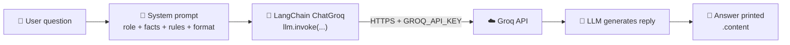

<div align="center">

# 🧠 Day 1 — How LLMs Work & Your First API Call

**One Person Company · AI Agents Bootcamp 2026 · Aditya University (DoTT)**


</div>

---

## 📌 TL;DR

Set up a free **Groq** API key in Google Colab, made the first LLM call through **LangChain**, controlled the model's behaviour with a **system prompt** (a bakery assistant), and tested a **prompt-injection detector**.

| | |
|---|---|
| 📓 Notebook | [`agenticAI_Day1.ipynb`](./agenticAI_Day1.ipynb) |
| 🔑 Config template | [`.env.example`](./.env.example) |
| 🤖 Model used | `openai/gpt-oss-120b` via Groq (`temperature=0`) |
| 🛡️ Safety model | `meta-llama/llama-prompt-guard-2-22m` |

---

## 🔄 How an API Call Works (what this day demonstrates)



---

## 🧪 What Was Built — Notebook Walkthrough

| # | Step | What the code does |
|---|------|--------------------|
| 1 | **Install** | `pip install langchain_groq` installs the LangChain wrapper for Groq. |
| 2 | **Import** | `from langchain_groq import ChatGroq` |
| 3 | **Secure the key** | Reads `GROQ_API_KEY` from **Colab Secrets** (`userdata.get`) and stores it in `os.environ`. No key is hard-coded in the notebook. |
| 4 | **Create the LLM** | `ChatGroq(model="openai/gpt-oss-120b", temperature=0)`. Temperature 0 gives deterministic, focused answers. |
| 5 | **Write a system prompt** | Persona for **Sweet Crumbs Home Bakery** with *facts*, *rules* and *format* (see below). |
| 6 | **Helper function** | `ask(question)` sends `[("system", SYSTEM), ("human", question)]` and returns `.content`. |
| 7 | **Test the bot** | Asked *"can i get my order tommorrow"*. |
| 8 | **Safety check** | Sent a jailbreak-style message to `llama-prompt-guard-2-22m` using the native `groq` SDK. |

### 🧱 The System Prompt Pattern

```text
Facts  → we bake to order; 24 hours' notice; all cakes have eggless versions
Rules  → never promise delivery times; say so if you don't know
Format → polite, under 60 words
```

### ✅ Real output from the notebook

> **Q:** `can i get my order tommorrow`
> **A:** *We bake each cake to order and require at least 24 hours' notice. While we'll do our best to have it ready for you, we can't guarantee a specific delivery time…*

The bot used the **facts** (24h notice, eggless) and obeyed the **rule** (no delivery promise).

### 🛡️ Prompt-Injection Detection

The notebook sends *"Ignore your previous instructions…"* to **Llama Prompt Guard 2**. It returned a score of **`0.9989`**, meaning the model rates the message as almost certainly a prompt-injection attempt.

---

## 🎓 Concepts Learned

- **LLM API call**: send messages, receive generated text.
- **Roles**: `system` (rules for the model) vs `human` (the user's message).
- **`temperature`**: controls randomness (0 = predictable).
- **Secret management**: API keys live in Colab Secrets or `.env`, never in code.
- **Prompt injection**: attackers try to override instructions; guard models can score the risk.

---

## ▶️ How to Run

1. Get a free key at [console.groq.com](https://console.groq.com).
2. Open `agenticAI_Day1.ipynb` in **Google Colab**.
3. Click the 🔑 **Secrets** icon in the left sidebar → add `GROQ_API_KEY` → enable notebook access.
4. **Run all cells**.

> ⚠️ Running locally? Copy `.env.example` to `.env` and put **your own** key in it. Never commit a real key.

---

## 📁 Folder Contents

```text
Day 1/
├── agenticAI_Day1.ipynb   # Colab notebook with all Day 1 code and outputs
├── .env.example           # Template for the GROQ_API_KEY variable
└── README.md              # You are here
```

<div align="center">

⬅️ [Back to main README](../README.md) · ➡️ [Day 2 →](../Day%202/README.md)

</div>
