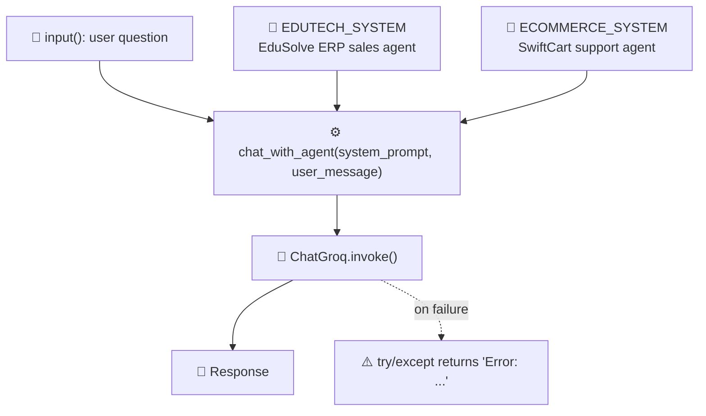

<div align="center">

# ✍️ Day 2 — Prompt Engineering & Reusable Agent Personas

**One Person Company · AI Agents Bootcamp 2026 · Aditya University (DoTT)**


</div>

---

## 📌 TL;DR

Turned Day 1's single bakery bot into a **reusable pattern**: one function, `chat_with_agent(system_prompt, user_message)`, that powers **different business agents** just by swapping the system prompt. Two agents were built: an **EdTech ERP sales assistant** and an **e-commerce support agent**.

| | |
|---|---|
| 📓 Notebook | [`Day_2.ipynb`](./Day_2.ipynb) |
| 🤖 Model configured | `llama-3.3-70b-specdec` via Groq (`temperature=0`) |
| 🧩 Technique | Structured system prompts: **Role → Facts → Rules → Format** |

---

## 🧠 The Idea: One Engine, Many Personas



The code is identical for both agents. **Only the prompt changes**, and that is the core lesson of prompt engineering.

---

## 🤖 The Two Agents

| | 📘 EduSolve ERP (Sales) | 🛒 SwiftCart (Support) |
|---|---|---|
| **Variable** | `EDUTECH_SYSTEM` | `ECOMMERCE_SYSTEM` |
| **Business** | ERP software for schools, retail and hospitals | Amazon-style online store |
| **Facts given** | Streamlines operations, billing, scheduling; free 14-day trial | Order tracking via profile; 30-day returns; 3-5 day shipping |
| **Rules** | Never quote prices (push a demo); never promise instant deployment; hand off unknown details to a human | Never promise refunds before checking order status; never ask for full card numbers; be very empathetic |
| **Format** | Professional, enthusiastic, under 60 words | Polite, concise, under 60 words |

### 🧱 Prompt Anatomy used in both

```text
Role    → "You are the expert sales assistant for ..."
Facts   → what the model is allowed to treat as true
Rules   → hard guardrails (what it must NOT do)
Format  → tone and length limit
```

---

## 🔧 Code Highlights

- **Secure key loading**: `userdata.get('GROQ_API_KEY')` from Colab Secrets, with a friendly message if missing.
- **Quiet install**: `pip install -q groq langchain_groq`.
- **Error handling**: the helper wraps `llm.invoke(...)` in `try/except`, so failures return a readable `Error: ...` string instead of crashing the notebook.
- **Interactive chat**: each agent cell uses `input()` to take a live question from the user.

---

## 📝 Honest Run Note

The notebook's **saved outputs show `Error: Connection error.`** for both agents (the test message was `"hi"`). This means the API call did not complete during that Colab session (for example, no network or the key was not accessible at that moment, or the model name is no longer served). The `try/except` handling worked as designed, and the system prompts and code structure are complete. To see live replies, re-run the notebook with a valid `GROQ_API_KEY` secret and a currently available Groq model.

---

## 🎓 Concepts Learned

- **System prompt vs user prompt**: persistent rules vs the per-turn question.
- **Guardrails in prompts**: "never promise X" rules shape safe behaviour.
- **Reusability**: one function, many agents.
- **Defensive coding**: catching API errors gracefully.

---

## ▶️ How to Run

1. Open `Day_2.ipynb` in **Google Colab**.
2. Add `GROQ_API_KEY` in the 🔑 **Secrets** sidebar and enable access.
3. Run all cells, then type a question when prompted, for example:
   - EduSolve: *"Do you have a free trial?"* / *"How much does it cost?"* (should push a demo)
   - SwiftCart: *"Can I return an item?"* / *"I want a refund now"* (should check order status first)

---

## 📁 Folder Contents

```text
Day 2/
├── Day_2.ipynb   # Two prompt-engineered agents + shared chat helper
└── README.md     # You are here
```

<div align="center">

⬅️ [← Day 1](../Day%201/README.md) · [Main README](../README.md) · ➡️ [Day 3 →](../Day%203/README.md)

</div>
