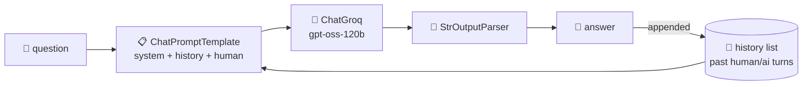

<div align="center">

# 🔗 Day 3 — Chains, Conversation Memory, Testing & Your First Agent

**One Person Company · AI Agents Bootcamp 2026 · Aditya University (DoTT)**


</div>

---

## 📌 TL;DR

Rebuilt the **Sweet Crumbs Bakery** bot with a proper **LangChain chain**, gave it **memory** (it remembers the user's name), wrote an **automated CSV test suite** (**3/3 passed, 100%**), and started the **first agent** with `create_agent`.

| | |
|---|---|
| 📓 Notebook | [`Day_3.ipynb`](./Day_3.ipynb) |
| 🤖 Model | `openai/gpt-oss-120b` via Groq (`temperature=0.3`) |
| 🧩 Key pattern | `prompt \| llm \| StrOutputParser()` (LCEL chain) |
| 🧠 Memory | A manual `history` list injected with `MessagesPlaceholder` |

---

## 🏗️ Architecture



---

## 🧪 What Was Built — Step by Step

### 1️⃣ Smarter system prompt (ROLE / FACTS / RULES / FORMAT)

| Section | Content |
|---|---|
| **ROLE** | Friendly assistant for Sweet Crumbs Home Bakery |
| **FACTS** | Plum cake Rs 500 · Chocolate cake Rs 650 · Cupcake Rs 80 · 24-hour notice · eggless available |
| **RULES** | Never promise delivery time or place; if not in FACTS say *"I'll check with the owner."*; calculate totals carefully |
| **FORMAT** | Under 50 words, friendly, **English or Telugu** matching the customer |

### 2️⃣ A chain with memory

```python
prompt = ChatPromptTemplate.from_messages([
    ("system", SYSTEM),
    MessagesPlaceholder("history"),   # chat so far
    ("human", "{question}"),
])
chain = prompt | llm | StrOutputParser()
```

`ask(question)` calls the chain, then appends both the question and the answer to `history`, so the next call sees the full conversation.

### 3️⃣ Memory demo (real output)

| Turn | Message | Reply |
|---|---|---|
| 1 | *"Hi, I'm Pranav. Do you make Vanilla cup cakes?"* | *"I'll check with the owner."* (vanilla is not in FACTS, so the bot refuses to guess ✅) |
| 2 | *"What's my name?"* | *"Your name is Pranav."* (memory works ✅) |

### 4️⃣ Automated test suite

`run_tests()` reads `test.csv`, runs each question through the chain with **empty history**, and checks that the answer **contains** the expected keyword.

| Question | Must include | Result |
|---|---|---|
| Do you make eggless cakes? | `yes` | ✅ PASS |
| How much is a Chocolate cake? | `650` | ✅ PASS |
| Can I get a delivery today? | `owner` | ✅ PASS |

**Score: `3/3 passed (100%)`**

### 5️⃣ First agent (work in progress)

The last cell imports `create_agent` from `langchain.agents` and creates `agent_order` with `tools=[]` (the comment says tools arrive on Day 4).

> ⚠️ **Known issue:** the cell then calls `agent.invoke(...)` and `result[...]`, but the variables are named `agent_order` and `result_order`, so that cell raises a `NameError` as written. The fix is to use the matching names:
> ```python
> result_order = agent_order.invoke({"messages": [{"role": "user", "content": "Do you make eggless cakes?"}]})
> print(result_order["messages"][-1].content)
> ```

---

## 🎓 Concepts Learned

- **LCEL chains**: compose steps with the `|` operator.
- **Conversation memory**: pass history back to the model on each turn.
- **Grounded answers**: the bot only states what is in FACTS, and defers otherwise.
- **Prompt regression testing**: automated pass/fail checks with a CSV file.
- **Agents**: an LLM wrapped with tools and a system prompt (tools come next).

---

## ▶️ How to Run

1. Open `Day_3.ipynb` in **Google Colab**.
2. Add `GROQ_API_KEY` under 🔑 **Secrets** and enable access.
3. Run all cells in order. The notebook creates its own `/content/test.csv`, so no extra files are needed.

---

## 📁 Folder Contents

```text
Day 3/
├── Day_3.ipynb   # Chain, memory, CSV tests, first agent
└── README.md     # You are here
```

<div align="center">

⬅️ [← Day 2](../Day%202/README.md) · [Main README](../README.md)

</div>
