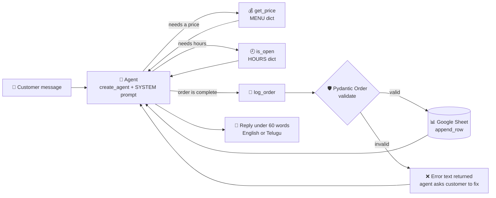

<div align="center">

# 🛠️ Day 4 — Tools, Pydantic & Google Sheets

**One Person Company · AI Agents Bootcamp 2026 · Aditya University (DoTT)**


-34A853?logo=googlesheets&logoColor=white)


</div>

---

## 📌 TL;DR

Day 3 ended with `create_agent(..., tools=[])`. On Day 4 the **Sweet Crumbs Home Bakery** agent gets **three tools**: it can look up prices, check opening hours, and **save a validated order into a Google Sheet**. A **Pydantic `Order` model** guards every write.

| | |
|---|---|
| 📓 Notebook | [`Day_4.ipynb`](./Day_4.ipynb) |
| 🤖 Model | `openai/gpt-oss-20b` via Groq (`temperature=0.2`, `max_retries=3`) |
| 🛠️ Tools | `get_price` · `is_open` · `log_order` |
| 🛡️ Validation | Pydantic `Order` (`Literal` menu items, `qty >= 1`) |
| 📊 Data store | Google Sheet **"Sweet Crumbs Orders"** via `gspread` |
| 🧠 Memory | Full message history reused across turns |

---

## 🏗️ Architecture



---

## 🧪 Notebook Walkthrough (3 cells)

### Cell 1 — Setup: LLM + Google Sheets
| Step | Code idea |
|---|---|
| Install | `langchain`, `langchain-groq`, `gspread` |
| Secure key | `GROQ_API_KEY` read from **Colab Secrets** |
| LLM | `ChatGroq(model="openai/gpt-oss-20b", temperature=0.2, max_retries=3)` |
| Google auth | `auth.authenticate_user()` + `gspread.authorize(creds)` |
| Create sheet | `gc.create("Sweet Crumbs Orders")` and a header row: `name, item, qty, date, eggless, total` |

### Cell 2 — Data, Pydantic model and tools

**Business data** (plain Python dictionaries):

| Menu item | Price |
|---|---|
| plum cake | Rs 500 |
| chocolate cake | Rs 650 |
| cupcake | Rs 80 |

Opening hours: **Mon-Sat 9 am to 8 pm**, **Sunday 10 am to 6 pm**.

**Pydantic schema**

```python
class Order(BaseModel):
    name: str
    item: Literal["plum cake", "chocolate cake", "cupcake"]   # only menu items allowed
    qty: int = Field(ge=1)                                    # at least 1
    date: str
    eggless: bool
```

**Tools**

| Tool | Purpose | Behaviour |
|---|---|---|
| `get_price(item, qty=1)` | Total price | Returns `"2 x chocolate cake = Rs 1300"`, or lists the menu if the item is unknown. |
| `is_open(day)` | Opening hours | Returns hours for the day, or an error for an invalid day. |
| `log_order(name, item, qty, date, eggless)` | Save an order | Validates with `Order`, computes the total from `MENU`, appends a row to the sheet. On a validation error it returns a message telling the agent to ask the customer to correct it. |

### Cell 3 — Agent, memory and a 5-question test

- `create_agent(model=llm, tools=[get_price, is_open, log_order], system_prompt=SYSTEM)`
- **System prompt rules:** always use tools for prices and timings (never guess); collect name, item, quantity and pickup date before `log_order`; read the order back with the total after saving.
- **Memory:** `chat()` stores `result["messages"]` in `history` and passes it back on every call.
- **Error handling:** `try/except` returns a polite fallback message if the agent fails.

---

## ✅ Real Test Results

| # | Customer says | Agent behaviour |
|---|---|---|
| Q1 | *"Are you open on Sunday? How much are 2 chocolate cakes?"* | Used `is_open` and `get_price`: open 10 am to 6 pm, total **Rs 1,300**. Then asked for the missing order details. |
| Q2 | *"I'm Ravi. Please book 2 eggless chocolate cakes for 24 Dec."* | Called `log_order`, confirmed the order, total **Rs 1,300**. |
| Q3 | *"Change that to 5 cupcakes instead."* | Asked whether the cupcakes should be eggless before proceeding. |
| Q4 | *"Do you sell apple pies?"* | Said apple pies are not on the menu. |
| Q5 | *"What time do you close on Saturdays?"* | Answered **8 pm** (from the hours table). |

---

## 🔍 Observations & Limitations

Documented honestly so the next iteration is clear:

- **Create only.** The sheet supports appending orders. There is **no update or delete tool**, so Q3 (change an order) can only collect details, not edit Ravi's saved row. Adding `update_order` and `cancel_order` tools is the natural next step.
- **Reads come from dictionaries** (`MENU`, `HOURS`), not from the sheet.
- **`gc.create(...)` makes a new spreadsheet on every run.** The notebook comment says to switch to `gc.open("Sweet Crumbs Orders")` after the first run.
- **Dates are free text** (`date: str`), so "24 Dec" is stored as typed.
- **Q4 wording** mentions "other treats", which goes slightly beyond the facts in the prompt. A stricter FACTS section would prevent this.

---

## 🎓 Concepts Learned

- **Tool calling:** the LLM requests a function; Python executes it and returns the result.
- **`@tool` decorator:** the docstring and type hints become the tool's description and schema for the model.
- **Pydantic validation:** `Literal` and `Field(ge=1)` stop bad data before it reaches the sheet.
- **Google Sheets as a database** with `gspread` (`append_row`).
- **Prompt rules for tool use:** "always use the tool, never guess".
- **Agent memory:** reusing the message list across turns.

---

## ▶️ How to Run

1. Open `Day_4.ipynb` in **Google Colab**.
2. Add `GROQ_API_KEY` under 🔑 **Secrets** and enable notebook access.
3. Run cell 1 and approve the Google sign-in prompt (it creates the sheet in your Drive).
4. Run cells 2 and 3, then open the printed sheet URL and check that Ravi's order row appears.

> The sheet is created in your own Google Drive and is private unless you share it.

---

## 📁 Folder Contents

```text
Day 4/
├── Day_4.ipynb   # Setup, Pydantic model, 3 tools, agent with memory, tests
└── README.md     # You are here
```

<div align="center">

⬅️ [← Day 3](../Day%203/README.md) · [Main README](../README.md)

</div>
